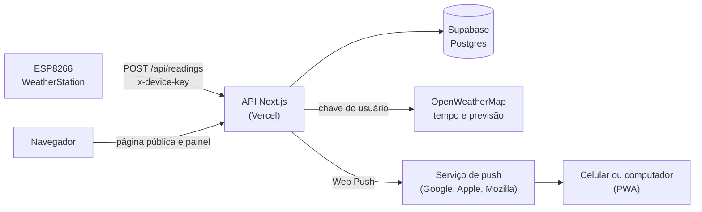

# 🌦️ WeatherStation Painel

Painel web para acompanhar uma ou mais estações meteorológicas **ESP8266**: recebe as leituras por uma **API REST**, guarda o histórico no **Supabase**, mostra **gráficos**, o **tempo e a previsão** da cidade (OpenWeatherMap), **diagnóstico do dispositivo**, **página pública**, **usuários com permissões**, **tema claro e escuro**, **app instalável (PWA)** e **notificações push** com alertas por ESP. Feito com **Next.js** e hospedado no **Vercel**.


> Este painel é o par do firmware **WeatherStation ESP8266** (veja o README do firmware): o ESP envia 20 campos a cada 15 min e este projeto os recebe, guarda e exibe.

<!-- Adicione suas capturas de tela em docs/img/ e referencie aqui, por exemplo:


-->

---

## 📑 Sumário

1. [Recursos](#-recursos)
2. [Como funciona](#-como-funciona)
3. [Páginas do painel](#-páginas-do-painel)
4. [Tecnologias](#-tecnologias)
5. [Instalação](#-instalação)
6. [Primeiro acesso](#-primeiro-acesso)
7. [Usuários e permissões](#-usuários-e-permissões)
8. [Notificações e alertas](#-notificações-e-alertas)
9. [App instalável (PWA)](#-app-instalável-pwa)
10. [Integração com o ESP8266 (API)](#-integração-com-o-esp8266-api)
11. [Rotas da API](#-rotas-da-api)
12. [Banco de dados](#-banco-de-dados)
13. [Personalização no código](#-personalização-no-código)
14. [Segurança](#-segurança)
15. [Solução de problemas](#-solução-de-problemas)
16. [Estrutura do repositório](#-estrutura-do-repositório)
17. [Histórico de versões](#-histórico-de-versões)
18. [Ideias futuras](#-ideias-futuras)
19. [Créditos e licença](#-créditos-e-licença)

---

## ✨ Recursos

**Leituras e gráficos**
- Temperatura e umidade do sensor do ESP, com uma casa decimal.
- Gráfico de temperatura e umidade com período de **24 horas, 7 dias ou 30 dias** (nos períodos longos, médias por hora para ficar leve no celular).
- **Estatísticas do período**: mínima (com data e hora), máxima (com data e hora) e média de temperatura e umidade.
- **Sensação térmica** (índice de calor) e **ponto de orvalho** com indicador de conforto, calculados pelo sensor.
- **Exportação CSV** das leituras do período (abre direto no Excel em português).

**Clima da cidade (OpenWeatherMap)**
- Cada leitura guarda a **cidade** (código do OpenWeatherMap e nome); o painel tem seletor de dispositivo e de cidade.
- **Tempo agora** em destaque (temperatura, sensação, umidade, vento, pressão, nascer e pôr do sol), com fundo de dia ou de noite conforme o ícone.
- **Previsão dos próximos 4 dias**: máxima, mínima, descrição, ícone e chance de chuva.
- A consulta é feita no servidor com a chave do usuário; a chave nunca vai para o navegador.

**Dispositivos**
- Cadastro de ESPs pelo ID, com nome e descrição, e **cadastro automático** no primeiro envio (nome e descrição em branco).
- Status **online/offline** pelo intervalo de envio informado pelo ESP.
- **Wi-Fi** (% e dBm), **bateria** (ícone, percentual, tensão, ativa ou inativa, aviso de baixa) e **alimentação** (energia externa ou bateria).
- **Diagnóstico**: estado do sensor, tempo ligado, motivo do último reinício (travamentos em vermelho), memória livre, intervalo de envio, tela do OLED e ID do chip.
- **Sensor com defeito**: o painel avisa, não grava a leitura repetida ou `0.0` e mantém a última leitura boa.
- **Atalho para a página do ESP**: para admins, o IP é um link para `http://IP/` (mesma rede). Os demais usuários veem só o IP.

**Acesso**
- **Página pública** na tela inicial, sem login, só com os ESPs que o admin marcar (sem IP, firmware, Wi-Fi nem bateria). Botão **Entrar** no canto superior direito.
- **Usuários** do tipo **admin** (vê tudo) ou **normal** (só os ESPs liberados pelo admin).
- **Chave do OpenWeatherMap por usuário**, mascarada na interface (`************56f5`).
- **Usuário principal** (`ADMIN_USER`): sempre admin, com acesso de emergência pela `ADMIN_PASSWORD`.

**Notificações e app**
- **Notificações push** mesmo com o app fechado: limites de temperatura e umidade e aviso de bateria **por ESP**, mais eventos (queda de energia, falha do sensor, reinício inesperado).
- **PWA instalável** no celular e no computador, com ícone próprio e página amigável sem internet.
- **Tema claro e escuro** (lembra a escolha; na primeira visita segue o sistema).
- Painel lembra o **último dispositivo e a última cidade** escolhidos.
- Layout responsivo; mensagens de resultado ao lado de cada botão de salvar.

---

## 🧭 Como funciona



O navegador e o ESP nunca falam direto com o banco: todo acesso passa pela API, que guarda as chaves.

| Tarefa | Intervalo |
|---|---|
| Envio do ESP à API | a cada 15 min (informado em `send_interval_s`) |
| ESP considerado offline | sem leitura há mais de 2,5 vezes o intervalo de envio (37,5 min com envio a cada 15 min; se o ESP não informar `send_interval_s`, o painel assume 15 min) |
| Atualização da lista de dispositivos e do gráfico no painel | a cada 60 s |
| Tempo agora (OpenWeatherMap) | a cada 10 min (cache de 5 min no servidor) |
| Previsão (OpenWeatherMap) | a cada 30 min (cache de 5 min no servidor) |
| Aviso repetido de limite fora da faixa | a cada 2 h (temperatura e umidade) e 6 h (bateria), enquanto continuar fora |
| Sessão de login | 7 dias |

---

## 📱 Páginas do painel

| Página | Acesso | O que tem |
|---|---|---|
| **`/`** (pública) | todos | Seletor de dispositivo e cidade, tempo agora, previsão, sensor (temperatura, umidade, sensação térmica e ponto de orvalho) e histórico com estatísticas. Botão **Entrar** (ou **Painel**, se já estiver logado), tema e **Instalar app** |
| **`/login`** | todos | Usuário e senha, com link para voltar à página pública |
| **`/painel`** | logado | Tudo da página pública, mais **Wi-Fi**, **bateria** e **alimentação**, aviso de sensor com defeito, **exportar CSV** e o bloco **Dispositivo** com o diagnóstico completo |
| **`/devices`** | logado | Lista os ESPs com nome e descrição editáveis, status, cidade, IP (link para admin) e bateria. **Admin**: cadastrar, excluir e marcar como público |
| **`/users`** | admin | Criar usuários, mudar tipo, chave do OpenWeatherMap (mascarada), senha e **ESPs liberados** de cada usuário normal |
| **`/account`** | logado | Chave do OpenWeatherMap, troca de senha, **ativar notificações neste aparelho** e **alertas por ESP** |

**Cartões do sensor:** a bateria fica verde acima de 40%, amarela até 40% e vermelha até 15% (com aviso de bateria baixa, que não aparece com energia externa). O Wi-Fi em % vem de `2 × (rssi + 100)`, limitado de 0 a 100.

---

## 🧰 Tecnologias

| Camada | Tecnologia |
|---|---|
| Aplicação | **Next.js 15** (App Router), **React 19**, **TypeScript** |
| Gráficos | **Recharts** |
| Banco | **Supabase** (Postgres) com `@supabase/supabase-js`, acesso só pelo servidor |
| Sessão | **jose** (JWT em cookie `httpOnly`) e senhas com `scrypt` (Node `crypto`) |
| Validação da API do ESP | **Zod** |
| Notificações | **web-push** (VAPID) e Service Worker |
| Clima | API do **OpenWeatherMap** (`weather` e `forecast`) |
| Visual | Fontes **Space Grotesk** e **JetBrains Mono** (`next/font`), tema por variáveis CSS |
| Hospedagem | **Vercel** |

---

## 💻 Instalação

### 1. Supabase
1. Crie um projeto em [supabase.com](https://supabase.com).
2. No **SQL Editor**, rode os scripts:

| Situação | O que rodar |
|---|---|
| **Banco novo** | `schema.sql` |
| **Banco de uma versão anterior** | `migration.sql`, `migration-v2.sql`, `migration-v3.sql` e `migration-v4.sql`, nessa ordem, pulando os que já rodou (todos mantêm os dados) |

3. Em **Project Settings → API**, copie a **URL do projeto**. Em **API Keys**, copie a chave secreta (`sb_secret_...`) ou, na aba *Legacy API Keys*, a `service_role`.

### 2. Chaves das notificações
Gere o par de chaves uma vez, no seu computador:

```bash
npx web-push generate-vapid-keys
```

### 3. Vercel
1. Suba este repositório para o GitHub e importe em [vercel.com](https://vercel.com) (**Add New → Project**). O preset deve ser Next.js.
2. Em **Settings → Environment Variables**, crie as variáveis abaixo e faça o deploy (variáveis só valem para deploys novos; depois de criá-las, faça um *Redeploy*).

| Variável | Para que serve |
|---|---|
| `SUPABASE_URL` | URL do projeto Supabase |
| `SUPABASE_SERVICE_ROLE_KEY` | Chave de servidor do Supabase (nunca use o prefixo `NEXT_PUBLIC_`) |
| `DEVICE_KEY` | Senha longa que o ESP envia no cabeçalho `x-device-key` |
| `ADMIN_USER` | Usuário principal (sempre admin) |
| `ADMIN_PASSWORD` | Senha do usuário principal |
| `AUTH_SECRET` | Segredo para assinar a sessão (`openssl rand -base64 32`) |
| `VAPID_PUBLIC_KEY`, `VAPID_PRIVATE_KEY` | Par de chaves das notificações |
| `VAPID_SUBJECT` | Contato das notificações, no formato `mailto:seu@email` |
| `OWM_PUBLIC_KEY` | *Opcional.* Chave do OpenWeatherMap da página pública. Se vazia, usa a do usuário principal e, na falta dela, a de outro admin |

O arquivo `.env.example` tem um modelo. **Nunca envie o `.env` real para o GitHub.**

### Desenvolvimento local

```bash
cp .env.example .env.local   # preencha os valores
npm install
npm run dev                  # http://localhost:3000
```

---

## 🚀 Primeiro acesso

1. Abra o endereço do Vercel, clique em **Entrar** e use `ADMIN_USER` e `ADMIN_PASSWORD`. O usuário principal é criado no primeiro login e a senha dele é sempre a `ADMIN_PASSWORD`.
2. Em **Minha conta**, cadastre a sua **chave do OpenWeatherMap** (crie em <https://home.openweathermap.org/api_keys>; chaves novas podem levar até cerca de 2 horas para ativar).
3. Configure o ESP (`device_id`, URL `https://SEU-APP.vercel.app/api/readings` e `DEVICE_KEY`). No primeiro envio ele aparece sozinho em **Dispositivos**.
4. Em **Dispositivos**, dê um nome e uma descrição ao ESP. Para mostrá-lo na página pública, marque **Mostrar na página pública** e clique em **Salvar**.
5. Em **Usuários**, crie os demais usuários e marque os ESPs de cada um.
6. Em **Minha conta**, toque em **Ativar notificações neste aparelho**, use **Enviar teste** e defina os alertas de cada ESP.

> 💡 Para o tempo da cidade aparecer, o ESP precisa enviar `city_id` pelo menos uma vez.

---

## 👥 Usuários e permissões

| Ação | Sem login | Usuário normal | Admin |
|---|---|---|---|
| Ver a página pública | ✅ | ✅ | ✅ |
| Ver o painel | ❌ | só os ESPs liberados | todos |
| Editar nome e descrição do ESP | ❌ | só os liberados | todos |
| Cadastrar e excluir ESP | ❌ | ❌ | ✅ |
| Marcar ESP como público | ❌ | ❌ | ✅ |
| Criar usuários e liberar ESPs | ❌ | ❌ | ✅ |
| Exportar CSV | ❌ | só os liberados | todos |
| Alertas por ESP | ❌ | só os liberados | todos |
| Clicar no IP para abrir a página do ESP | ❌ | ❌ (só vê o IP) | ✅ |
| Trocar a própria chave e senha | ❌ | ✅ | ✅ |

**Usuário principal (`ADMIN_USER`):** é sempre admin, não pode ser excluído nem rebaixado, e a senha dele vem da variável `ADMIN_PASSWORD` (não é trocada pela tela). Serve de acesso de emergência.

**Chaves:** as chaves do OpenWeatherMap aparecem mascaradas (`************56f5`: só os 4 últimos caracteres). Para trocar, clique no campo e cole a nova; o valor mascarado nunca é regravado.

**ESP novo:** um ESP criado automaticamente pela API não tem nenhum usuário com acesso. Só o admin o vê até liberá-lo em **Usuários**.

---

## 🔔 Notificações e alertas

Cada usuário configura, **para cada ESP**, em **Minha conta → Alertas por ESP**:

| Campo | O que faz |
|---|---|
| Temperatura mínima / máxima | Avisa quando passar do limite (deixe em branco para não monitorar) |
| Umidade mínima / máxima | Idem, em % |
| Avisar bateria em (%) | Avisa quando a bateria chegar a esse percentual ou menos |
| Alertas ligados | Liga ou pausa os alertas do ESP |
| Avisar quando voltar ao normal | Também avisa quando o valor volta para dentro da faixa |
| Queda de energia | Avisa quando o ESP passa da energia externa para a bateria |
| Falha do sensor | Avisa quando `sensor_ok` vira `false` |
| Reinício inesperado | Avisa quando o ESP reinicia por exceção ou watchdog |

**Como funciona:**
- A cada leitura recebida, a API compara com os limites de cada usuário que tem acesso ao ESP e envia o push para os aparelhos dele, **mesmo com o app fechado**. Isso roda depois de responder ao ESP, sem atrasá-lo.
- O aviso sai quando o valor passa do limite e **se repete** depois de 2 h (6 h na bateria) se continuar fora.
- Uma **folga** evita avisos repetidos quando o valor oscila no limite: o "voltou ao normal" só vale depois de 0,5 °C, 2 % de umidade ou 5 % de bateria de margem.
- Enquanto o ESP está na **energia externa**, a bateria não gera aviso. Com o sensor com defeito, temperatura e umidade não são avaliadas.
- Só recebe quem ainda tem acesso ao ESP (admin ou liberado).
- Aparelhos que não existem mais (o serviço de push responde 404 ou 410) são removidos da lista automaticamente.

**Ativar no aparelho:** em **Minha conta**, toque em **Ativar notificações neste aparelho** (cada celular ou navegador ativa uma vez) e use **Enviar teste**.

> ⚠️ **iPhone:** só funciona com o app instalado pela Tela de Início (iOS 16.4 ou mais novo). **Android:** economia de bateria agressiva pode atrasar os avisos do navegador.

---

## 📲 App instalável (PWA)

- Botão **Instalar app** no topo, quando o navegador permite (Chrome e Edge). No iPhone: **Compartilhar → Adicionar à Tela de Início**.
- Ícone próprio, abre em tela cheia, cor da barra acompanha o tema.
- Sem internet, mostra uma página de aviso com botão para tentar de novo.
- Os **dados nunca ficam em cache**: o Service Worker só trata a navegação, para não exibir leituras antigas como se fossem atuais.
- O mesmo Service Worker (`public/sw.js`) recebe e exibe as notificações push; tocar abre o painel.

---

## 📡 Integração com o ESP8266 (API)

O ESP envia uma leitura por `POST` a cada 15 min (e ao clicar em **Enviar dados agora**).

**Configuração no ESP:** `device_id` (padrão `esp8266-` + ID do chip), URL `https://SEU-APP.vercel.app/api/readings` e `DEVICE_KEY` (a mesma variável do Vercel).

**Requisição**

| Item | Valor |
|---|---|
| Método | `POST` |
| Cabeçalhos | `Content-Type: application/json` e `x-device-key: <DEVICE_KEY>` |
| Sucesso | HTTP `200` com `{"ok":true}` |
| Erros | `400` (corpo inválido, com a lista `details`), `401` (chave errada) e `500` (erro no banco) |

**Corpo (JSON), 20 campos**

| # | Campo | Tipo | Obrigatório | Aceita `null` | Validação | Uso no painel |
|---|---|---|---|---|---|---|
| 1 | `device_id` | texto | **sim** | não | até 32 caracteres: letras, números, `-` `_` `.` | identifica o ESP (cria se não existir) |
| 2 | `temperature` | número | **sim** | não | -40 a 85 °C | tempo real, gráfico e alertas |
| 3 | `humidity` | número | **sim** | não | 0 a 100 % | tempo real, gráfico e alertas |
| 4 | `city_id` | inteiro | não | **sim** | inteiro positivo (aceita número em texto) | cidade do tempo e da previsão |
| 5 | `city_name` | texto | não | não | até 80 caracteres (pode ser vazio) | nome da cidade nos seletores |
| 6 | `ip` | texto | não | não | só caracteres de IP; senão é descartado | endereço (link para admin) |
| 7 | `rssi` | inteiro | não | não | valores acima de 0 viram vazio (o ESP8266 devolve 31 sem Wi-Fi) | sinal do Wi-Fi |
| 8 | `firmware` | texto | não | não | até 32 caracteres | versão |
| 9 | `battery_active` | booleano | não | não | | bateria ativa ou inativa |
| 10 | `battery` | inteiro | não | não | 0 a 100 | percentual da bateria |
| 11 | `battery_voltage` | número | não | não | 0 a 5 V | tensão da bateria |
| 12 | `external_power` | booleano | não | **sim** | | `true` energia externa, `false` bateria, `null` sem placa UPS |
| 13 | `sensor_ok` | booleano | não | não | ausente = ok | `false`: leitura não é gravada e o painel avisa |
| 14 | `uptime_s` | inteiro | não | não | ≥ 0 | tempo ligado e detecção de reinício |
| 15 | `reset_reason` | texto | não | não | até 40 caracteres | motivo do último reinício |
| 16 | `free_heap` | inteiro | não | não | ≥ 0 (bytes) | memória livre |
| 17 | `chip_id` | texto | não | não | até 16 caracteres | ID do chip |
| 18 | `send_interval_s` | inteiro | não | não | > 0 | define quando o ESP vira offline |
| 19 | `display_on` | booleano | não | não | | tela do OLED acesa |
| 20 | `rssi_pct` | inteiro | não | não | 0 a 100 | aceito e ignorado (o painel calcula pelo `rssi`) |

Só os campos **1 a 3** são obrigatórios; os demais são opcionais, então um ESP com firmware antigo continua sendo aceito. Campos desconhecidos são ignorados. O horário da leitura é o da **chegada no servidor** (`created_at`).

**O que o servidor faz ao receber**
1. Confere a `x-device-key` e valida o corpo (erros voltam em `details`, dizendo qual campo está errado).
2. Atualiza o último estado do ESP; se o `device_id` não existe, **cadastra automaticamente**.
3. Grava a leitura no histórico, **exceto** se `sensor_ok` for `false` (nesse caso, a última leitura boa é mantida).
4. Compara com o envio anterior e detecta **eventos**: queda ou volta da energia externa, sensor que parou ou voltou a ler e reinício inesperado (`uptime_s` menor que o anterior com motivo `Exception` ou `Watchdog`).
5. Responde ao ESP e, depois, verifica os alertas e envia as notificações.

**Exemplo**

```bash
curl -X POST "https://SEU-APP.vercel.app/api/readings" \
  -H "Content-Type: application/json" \
  -H "x-device-key: SUA_DEVICE_KEY" \
  -d '{"device_id":"esp8266-sala","temperature":24.5,"humidity":61.3,"city_id":3463011,"city_name":"Franca","ip":"192.168.0.50","rssi":-62,"firmware":"2.9","battery_active":true,"battery":83,"battery_voltage":4.02,"external_power":false,"sensor_ok":true,"uptime_s":86400,"reset_reason":"Power on","free_heap":24120,"chip_id":"A1B2C3","send_interval_s":900,"display_on":true,"rssi_pct":76}'
```

> O `uptime_s` volta a zero a cada cerca de 49 dias. Se isso coincidir com um último reinício registrado como exceção ou watchdog, o painel pode avisar um reinício inesperado que não existiu (raro).

---

## 🔗 Rotas da API

**Sem login**

| Método | Rota | Função |
|---|---|---|
| POST | `/api/readings` | Recebe a leitura do ESP (exige `x-device-key`) |
| POST | `/api/login` | Entra (cria o usuário principal no primeiro login) |
| GET | `/api/public/devices` | ESPs marcados como públicos (sem IP, firmware, Wi-Fi nem bateria) |
| GET | `/api/public/cities?device=ID` | Cidades de um ESP público |
| GET | `/api/public/readings?device=ID&hours=24&city=CODIGO` | Leituras de um ESP público |
| GET | `/api/public/weather?device=ID&city=CODIGO` | Tempo atual (só cidades já enviadas por um ESP público) |
| GET | `/api/public/forecast?device=ID&city=CODIGO` | Previsão (idem) |

**Com login**

| Método | Rota | Quem | Função |
|---|---|---|---|
| GET | `/api/devices` | logado | ESPs visíveis ao usuário |
| POST | `/api/devices` | admin | Cadastra ESP |
| PATCH | `/api/devices/[id]` | com acesso ao ESP | Nome e descrição (admin também define se é público) |
| DELETE | `/api/devices/[id]` | admin | Exclui o ESP e suas leituras |
| GET | `/api/readings?device=ID&hours=24&city=CODIGO` | com acesso ao ESP | Leituras do período (até 720 horas) |
| GET | `/api/cities?device=ID` | com acesso ao ESP | Cidades já enviadas pelo ESP |
| GET | `/api/weather?city=CODIGO` | logado | Tempo atual, com a chave do usuário |
| GET | `/api/forecast?city=CODIGO` | logado | Previsão dos próximos 4 dias |
| GET / POST | `/api/users` | admin | Lista e cria usuários |
| PATCH / DELETE | `/api/users/[id]` | admin | Tipo, chave, senha, ESPs liberados e exclusão |
| GET / PATCH | `/api/me` | logado | Dados do usuário; troca chave e senha |
| POST | `/api/logout` | logado | Sai |
| GET | `/api/alerts` | logado | Regras de alerta do usuário |
| PUT / DELETE | `/api/alerts/[id]` | com acesso ao ESP | Salva ou remove a regra de um ESP |
| GET | `/api/push/config` | logado | Chave pública das notificações |
| GET / POST / DELETE | `/api/push/subscribe` | logado | Registra ou remove este aparelho |
| POST | `/api/push/test` | logado | Envia uma notificação de teste |

---

## 💾 Banco de dados

| Tabela | Conteúdo |
|---|---|
| `users` | Usuários, hash da senha, tipo (`admin` ou `user`) e chave do OpenWeatherMap |
| `user_devices` | Quais ESPs cada usuário normal pode ver |
| `devices` | ESPs: nome, descrição, se é público, IP, Wi-Fi, bateria, firmware, cidade, última leitura e diagnóstico (alimentação, sensor, tempo ligado, reinício, memória, chip, intervalo e tela) |
| `readings` | Histórico de temperatura, umidade e cidade, com alimentação, tempo ligado, motivo do reinício e memória livre |
| `device_cities` | Cidades já usadas por cada ESP (alimenta o seletor) |
| `push_subscriptions` | Aparelhos registrados para receber notificações |
| `alert_rules` | Limites e eventos de alerta de cada usuário em cada ESP |
| `alert_state` | Quais alertas estão ativos e quando foi o último aviso (evita repetição) |

As tabelas têm **RLS ligado e nenhuma policy**: só a API, com a chave de servidor, acessa os dados. O volume é pequeno: com envio a cada 15 min são cerca de 35 mil leituras por ESP por ano.

---

## 🧩 Personalização no código

| Onde | O que muda |
|---|---|
| `lib/owm.ts` → `FORECAST_DAYS` | Quantos dias de previsão mostrar (4; a API gratuita cobre até 5) |
| `lib/owm.ts` → `revalidate: 300` | Cache do OpenWeatherMap no servidor (5 min) |
| `lib/alerts.ts` → `DEFS` | Folga (`margin`) e tempo para repetir o aviso (`remindHours`) de cada alerta |
| `lib/format.ts` → `isOnline` | Fator do offline (2,5 vezes o intervalo) e intervalo padrão (900 s) |
| `lib/format.ts` → `batteryInfo` | Faixas de cor da bateria (verde, amarelo até 40%, vermelho até 15%) |
| `lib/format.ts` → `wifiPct` | Fórmula do sinal Wi-Fi em % |
| `lib/readingSchema.ts` | Limites validados em cada campo da API |
| `app/api/readings/route.ts` → `ABNORMAL_RESET` | Quais motivos de reinício contam como inesperados |
| `components/Dashboard.tsx` → `PERIODS` | Períodos do gráfico (24 h, 7 dias, 30 dias; máximo de 720 horas na API) |
| `lib/auth.ts` e `app/api/login/route.ts` | Duração da sessão (7 dias) |
| `lib/push.ts` | Validade do aviso (`TTL` de 1 h) |
| `app/globals.css` (variáveis no topo) | Cores dos temas claro e escuro |
| `public/icons/` | Ícones do app |

---

## 🔐 Segurança

- **Chaves só no servidor:** a chave do Supabase e as do OpenWeatherMap nunca vão para o navegador. As chaves do OpenWeatherMap aparecem mascaradas na interface.
- **Senhas:** guardadas com `scrypt` e sal; a sessão é um JWT em cookie `httpOnly`, e o tipo do usuário é lido do banco a cada requisição (mudar o tipo ou excluir o usuário vale na hora).
- **`DEVICE_KEY` única:** quem a tiver consegue enviar leituras e criar dispositivos. Guarde-a e troque-a se vazar (variável no Vercel e no firmware).
- **Chaves do OpenWeatherMap em texto no banco:** não são mostradas de volta na interface, mas ficam gravadas sem criptografia.
- **Sem limite de tentativas de login:** use uma senha forte na `ADMIN_PASSWORD`.
- **Página pública:** expõe só os ESPs marcados, sem IP, firmware, Wi-Fi nem bateria. As consultas de tempo só aceitam cidades já enviadas por um ESP público, com cache de 5 min para proteger a cota do OpenWeatherMap.
- **Link do IP:** só aparece clicável para admins e só para endereços IP válidos; funciona apenas na mesma rede do ESP.
- **Nunca publique chaves no repositório.** O `.gitignore` já ignora o `.env`; confira antes de subir.

---

## 🩺 Solução de problemas

| Sintoma | O que verificar |
|---|---|
| **`404 DEPLOYMENT_NOT_FOUND`** | Endereço errado ou deploy que falhou: confira em **Deployments** no Vercel |
| **API responde `400 invalid payload`** | A resposta traz `details` com o campo errado (por exemplo, `device_id` com mais de 32 caracteres, temperatura fora de -40 a 85 ou corpo vazio) |
| **API responde `401 unauthorized`** | `x-device-key` diferente da `DEVICE_KEY` do Vercel |
| **API responde `500 db error`** | Variáveis do Supabase erradas, falta de *Redeploy* ou migrações não executadas |
| **ESP não aparece** | Confira a URL (`https`, terminando em `/api/readings`) e a `DEVICE_KEY`; o ESP aparece sozinho em **Dispositivos** no primeiro envio |
| **Usuário normal não vê nenhum ESP** | Um admin precisa liberar os ESPs em **Usuários** |
| **ESP aparece offline** | Sem leitura há mais de 2,5 vezes o intervalo de envio (37,5 min com 15 min) |
| **Gráfico sem dados** | Nenhuma leitura no período, ou a cidade selecionada não tem leituras (leituras antigas sem cidade só aparecem sem cidade) |
| **Aviso "O sensor parou de ler"** | O ESP enviou `sensor_ok: false`; confira ligação e alimentação do sensor |
| **"Tempo na cidade" indisponível** | Chave do OpenWeatherMap não cadastrada, recusada ou nova demais (até ~2 h para ativar). Se o `/painel` mostra o tempo mas a página pública não, defina `OWM_PUBLIC_KEY` ou cadastre a chave no usuário principal |
| **Tempo da cidade não aparece** | O ESP ainda não enviou `city_id` |
| **Página pública vazia** | Nenhum ESP marcado como público em **Dispositivos** |
| **Não chegam notificações** | Confira as variáveis `VAPID_*` e o `migration-v3.sql`, use **Enviar teste** em Minha conta e, no Android, desative a economia de bateria agressiva para o navegador |
| **Ativar notificações não funciona no iPhone** | Instale o app pela Tela de Início e abra por ele (iOS 16.4 ou mais novo) |
| **Limites de alerta "não gravam"** | Use vírgula ou ponto; a mensagem de resultado aparece ao lado do botão Salvar do ESP; confira se o `migration-v3.sql` e o `migration-v4.sql` foram executados |
| **Botão "Instalar app" não aparece** | O navegador só oferece em HTTPS e quando o app ainda não está instalado; no iPhone use *Adicionar à Tela de Início* |
| **Esqueci a senha do usuário principal** | Entre com `ADMIN_USER` e `ADMIN_PASSWORD` do Vercel: o usuário principal é restaurado no login |

---

## 📁 Estrutura do repositório

```
weatherstation-web/
├── app/
│   ├── page.tsx                  # página pública (tela inicial)
│   ├── painel/page.tsx           # painel com login
│   ├── devices/page.tsx          # dispositivos
│   ├── users/page.tsx            # usuários e acesso (admin)
│   ├── account/page.tsx          # minha conta, notificações e alertas
│   ├── login/page.tsx            # login
│   ├── manifest.ts               # manifesto do PWA
│   ├── layout.tsx, globals.css   # layout, fontes, tema
│   └── api/
│       ├── readings/             # ESP envia (POST) e painel consulta (GET)
│       ├── login/, logout/, me/  # sessão e dados do usuário
│       ├── users/, users/[id]/   # gestão de usuários (admin)
│       ├── devices/, devices/[id]/
│       ├── cities/, weather/, forecast/
│       ├── alerts/, alerts/[id]/ # regras de alerta
│       ├── push/                 # registro do aparelho, chave pública e teste
│       └── public/               # rotas sem login (só ESPs públicos)
├── components/                   # Dashboard, TopBar, PublicBar, Notifications, Battery,
│                                 # IpLink, StatusMsg, ThemeToggle, InstallButton, PwaRegister
├── lib/                          # auth, password, session, supabase, owm, readings,
│                                 # readingSchema, public, push, alerts, mask, format
├── public/                       # sw.js, offline.html e ícones do app
├── middleware.ts                 # protege páginas e API (exceto página pública, login e POST de leituras)
├── next.config.mjs
├── schema.sql                    # banco novo
├── migration.sql                 # usuários, cidades e acessos
├── migration-v2.sql              # página pública (is_public)
├── migration-v3.sql              # notificações push e alertas
├── migration-v4.sql              # diagnóstico do ESP e eventos de alerta
├── .env.example
└── README.md
```

---

## 📜 Histórico de versões

| Versão | Principais mudanças |
|---|---|
| **1.0** | Painel em Next.js + Supabase no Vercel, API `POST /api/readings`, gráficos de temperatura e umidade (24 h, 7 e 30 dias), Wi-Fi e bateria, login, cadastro de ESPs e cadastro automático no primeiro envio |
| **1.1** | **Usuários** (admin e normal), cidade do OpenWeatherMap salva com as leituras, seletor de cidade, tempo da cidade e **chave do OpenWeatherMap por usuário** |
| **1.2** | **Tema claro e escuro** com visual de meteorologia, **previsão dos próximos dias**, leituras com casa decimal, envio a cada 15 min e memória do último dispositivo e cidade |
| **1.3** | **Página pública** como tela inicial, **PWA instalável**, sensação térmica, ponto de orvalho, estatísticas do período, médias por hora e exportação CSV |
| **1.4** | **Notificações push** com alertas de temperatura, umidade e bateria **por ESP** |
| **1.5** | Atalho do IP para a página do ESP (admins), chaves mascaradas e mensagens de resultado ao lado dos botões |
| **1.6** | API com **20 campos** (diagnóstico do ESP), eventos de alerta (energia, sensor e reinício), validação com Zod e este README |

---

## 🔮 Ideias futuras

- Alerta de **ESP offline** (precisa de tarefa agendada, como o cron do Supabase).
- Detecção de **vazamento de memória** pela tendência de `free_heap` (o histórico já é guardado).
- **Qualidade do ar** da cidade e comparação entre dois ESPs.
- **Chave própria por ESP** no lugar da `DEVICE_KEY` única.
- Limite de tentativas de login e criptografia das chaves do OpenWeatherMap no banco.
- Resumos por hora e limpeza das leituras antigas, para manter o banco pequeno.
- **Configuração remota** do ESP pela resposta do envio (intervalo e cidade).
- Notificações por **Telegram** como canal extra, **MQTT / Home Assistant** e tradução do README para inglês.

---

## 🙏 Créditos e licença

- Dados meteorológicos e ícones do tempo: [OpenWeatherMap](https://openweathermap.org/).
- Banco: [Supabase](https://supabase.com/). Hospedagem: [Vercel](https://vercel.com/).
- Bibliotecas: [Next.js](https://nextjs.org/), [React](https://react.dev/), [Recharts](https://recharts.org/), [jose](https://github.com/panva/jose), [web-push](https://github.com/web-push-libs/web-push) e [Zod](https://zod.dev/).
- Fontes: Space Grotesk e JetBrains Mono (Google Fonts).
- Firmware: **WeatherStation ESP8266**, que é o par deste painel.

Este projeto é distribuído sob a **licença MIT**. Inclua um arquivo `LICENSE` na raiz do repositório.

```
MIT License

Copyright (c) 2026 SEU NOME

É concedida permissão, gratuitamente, a qualquer pessoa que obtenha uma cópia deste
software e dos arquivos de documentação associados, para lidar com o Software sem
restrições, incluindo, sem limitação, os direitos de usar, copiar, modificar, mesclar,
publicar, distribuir, sublicenciar e/ou vender cópias do Software, sujeito às condições
do texto completo da licença MIT (https://opensource.org/licenses/MIT).
```
